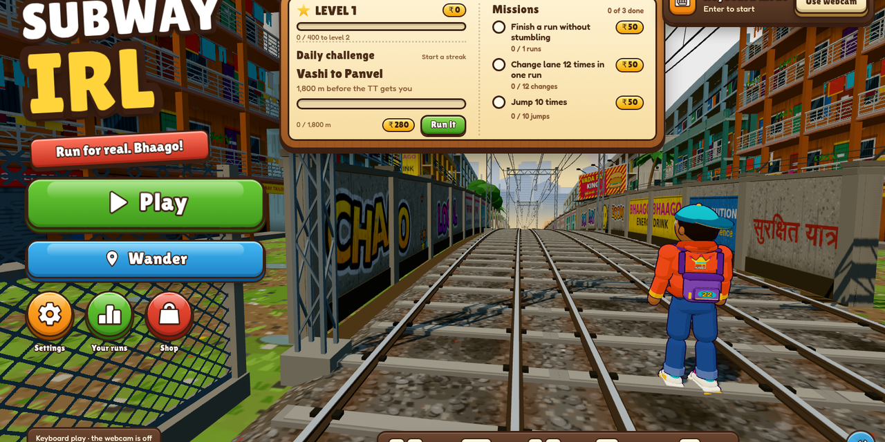
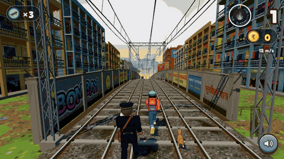
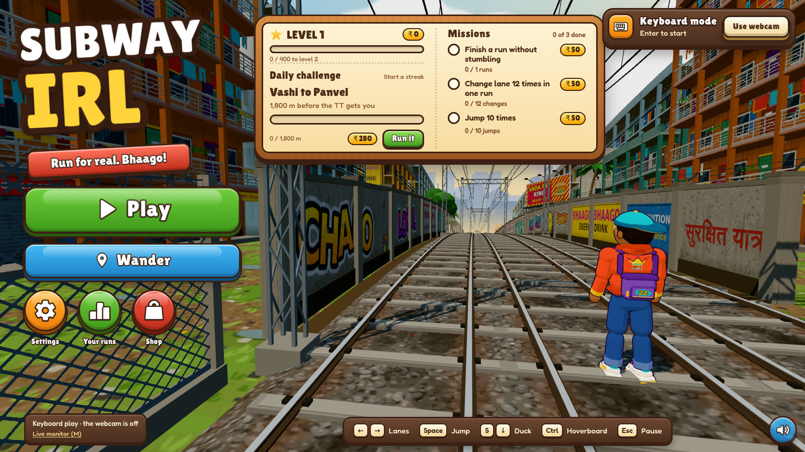
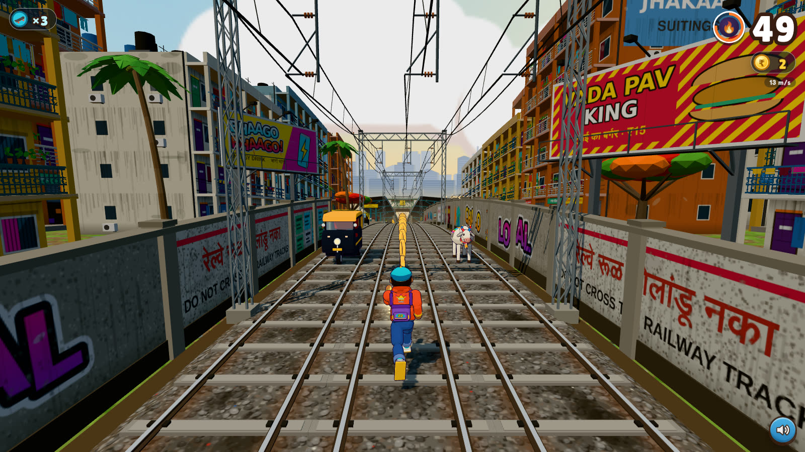
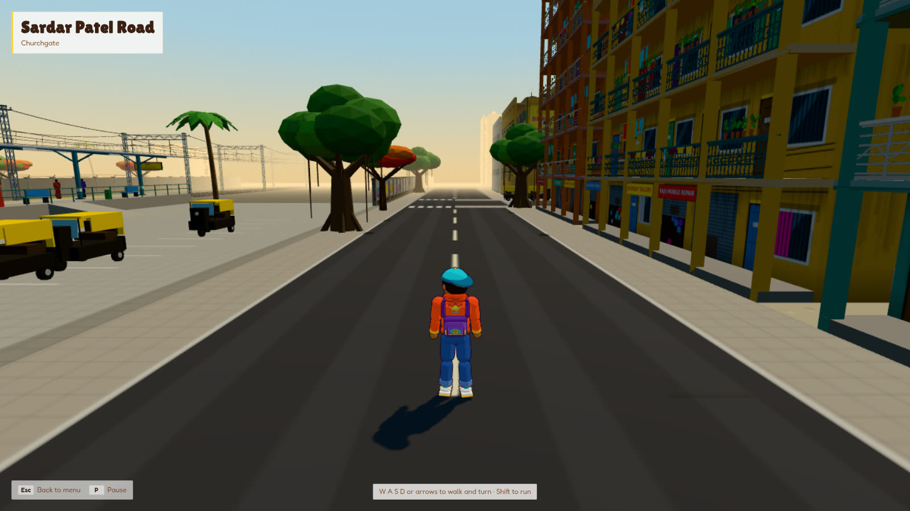
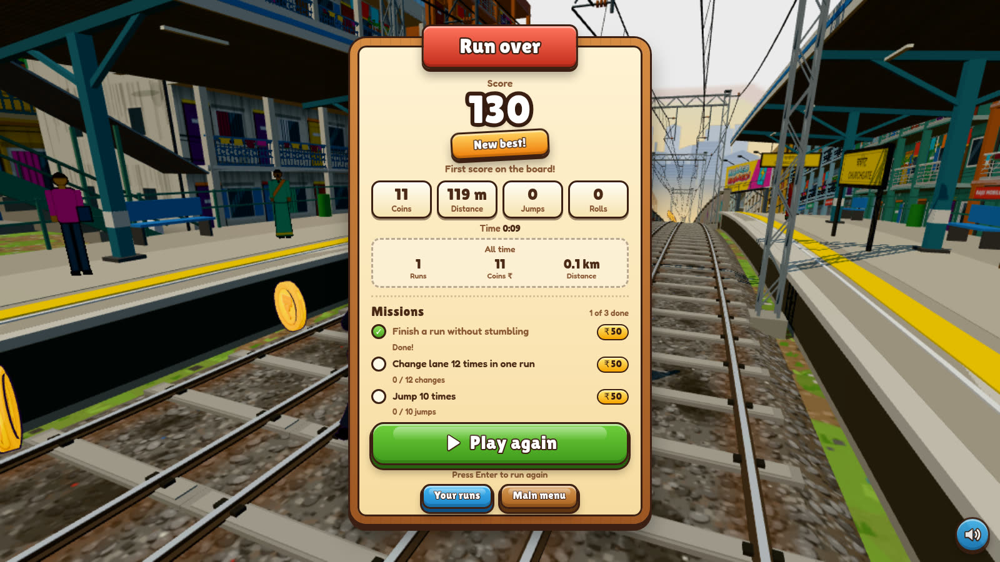
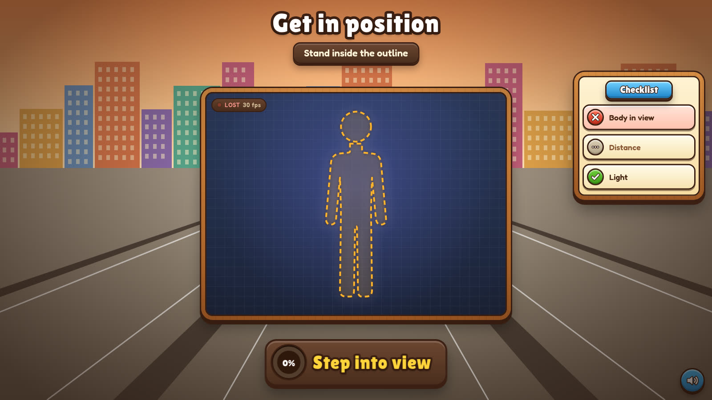
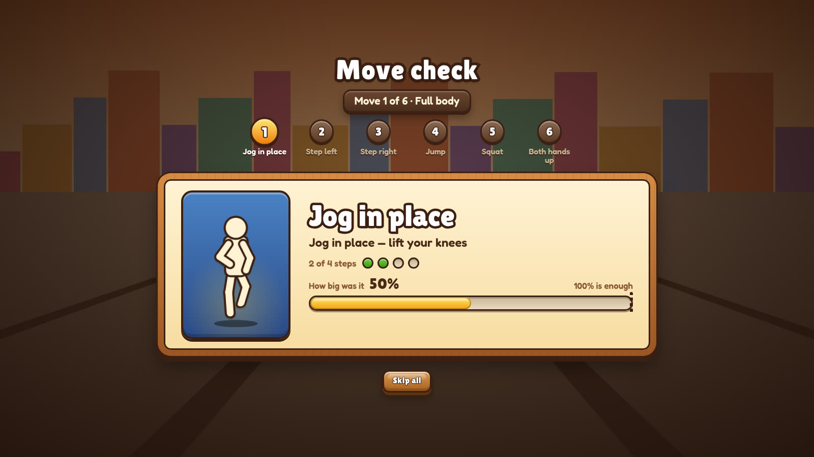
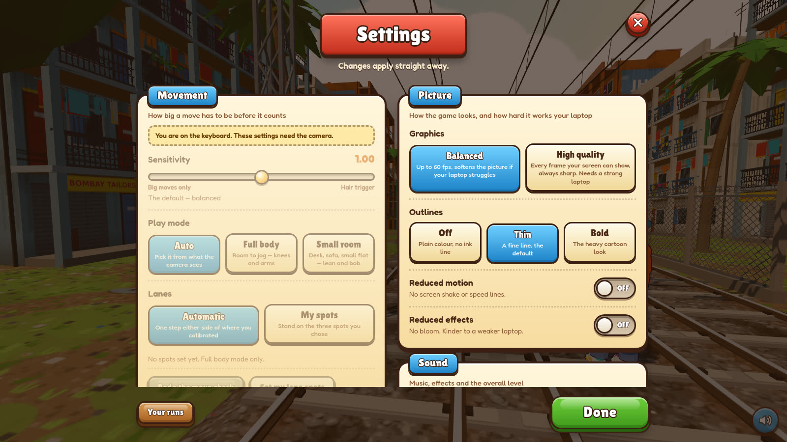
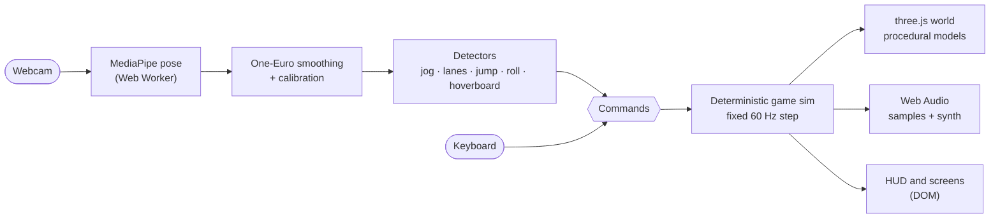

<div align="center">



# Subway IRL

### An endless runner you play with your body.
Jog in place in front of your webcam to run through Mumbai. Step to change lanes, jump to jump, squat to roll.<br />
Free, open source, and it runs entirely on your device: your video never leaves it.

[](https://yashism.github.io/Subway-IRL/)
[](https://github.com/Yashism/Subway-IRL/stargazers)

[](https://github.com/Yashism/Subway-IRL/actions/workflows/ci.yml)
[](https://github.com/Yashism/Subway-IRL/actions/workflows/pages.yml)
[](LICENSE)
[](https://github.com/Yashism/Subway-IRL/commits/main)
[](https://github.com/Yashism/Subway-IRL/issues)
[](CONTRIBUTING.md)
[](https://github.com/Yashism/Subway-IRL/network/members)


[**Play**](https://yashism.github.io/Subway-IRL/) ·
[**Features**](#features) ·
[**Run it locally**](#run-it-locally) ·
[**How it works**](#how-it-works) ·
[**Contribute**](#contributing) ·
[**Roadmap**](#roadmap)

<br />



<sub>The autopilot bot playing a run. Prefer video? <a href="docs/media/gameplay.mp4">gameplay.mp4</a></sub>

</div>

---

## What is this?

Subway IRL is a browser game in the spirit of the classic three-lane endless runners, with one twist: **you are the
controller**. A pose model watches you through your laptop webcam, and your real movement drives the runner.

- **Jog in place** to keep running. Stop for more than two seconds and the ticket inspector (the TT) catches you.
- **Step or lean** left and right to change lanes.
- **Jump** to jump, **squat** to roll under barriers.
- **Raise both hands** to ride a hoverboard, which also doubles as a short rest.

It is set on the Mumbai Local, with chawls, catenary masts, real station names for the Western, Central and
Harbour lines, graffiti, chai stalls and the TT who does not give up. It doubles as a small workout tracker (active
minutes, steps, a rough calorie estimate and a streak).

> **No webcam, or just want to try it?** The whole game also plays on the keyboard, so you can be running in ten seconds.

## Screenshots

<table>
  <tr>
    <td width="50%"><br /><sub><b>Title screen.</b> Play, Wander, daily challenge and missions.</sub></td>
    <td width="50%"><br /><sub><b>The run.</b> Dodge, jump, roll and collect coins.</sub></td>
  </tr>
  <tr>
    <td><br /><sub><b>Wander mode.</b> A relaxed free-roam walk through the city. No obstacles, no inspector.</sub></td>
    <td><br /><sub><b>Run summary.</b> Score, stats, missions and your best.</sub></td>
  </tr>
  <tr>
    <td><br /><sub><b>Calibration.</b> Stand in the outline and the game learns your body.</sub></td>
    <td><br /><sub><b>Move check.</b> Six guided moves tune the thresholds to <i>you</i>.</sub></td>
  </tr>
  <tr>
    <td colspan="2" align="center"><br /><sub><b>Settings.</b> Sensitivity, lanes, pace, obstacle difficulty, graphics quality and more.</sub></td>
  </tr>
</table>

## Features

| | |
|---|---|
| **Play with your body** | MediaPipe pose tracking in a Web Worker, One-Euro smoothing, and detectors for jogging, lane changes, jumping, rolling and the hoverboard gesture. |
| **Two play modes** | **Full body** (room to jog, lanes by stepping) and **Small room** (desk or sofa, lanes by leaning, arm pumps count as jogging). Auto-detected, overridable. |
| **It learns your body** | The **Move Check** walks you through each move, shows how far you got, and tunes thresholds to roughly 55 % of what you actually managed. Saved per mode. |
| **Your own lanes** | In full-body mode you can record **your own left / centre / right spots** instead of a fixed step size. |
| **Wander mode** | A free-roam, seeded Mumbai neighbourhood: streets, chawls, parks, a railway station with trains passing. Keyboard, or jog and lean with the camera. |
| **Fair by construction** | Obstacle patterns are checked by a passability solver, so every track is clearable at every difficulty. The simulation is **deterministic and seeded**. |
| **Progression** | Missions, a daily challenge (same track for everyone), levels, coins and a shop of runner skins and hoverboard colours. |
| **Workout tracker** | Active minutes, steps, a week chart with your streak, all-time totals and your last 30 runs. Calories are a rough estimate and labelled as one. |
| **Real sound** | Sampled CC0 cues with synthesised fallbacks, a jog-synced music bed and a heartbeat when the TT closes in. |
| **Runs on modest laptops** | A 60 fps cap, an adaptive render scale and a single-person pose model by default, with a **High quality** switch for strong machines. |
| **Private by design** | Everything runs locally. Nothing is recorded, uploaded or tracked. |
| **Built to be hacked on** | 1,600+ tests, a live pose monitor, session recording and replay, camera-free harness pages and a bot that plays the game. |

## Play

### In your browser

**[yashism.github.io/Subway-IRL](https://yashism.github.io/Subway-IRL/)**. Allow the camera, stand back far enough to be
seen, hold still for two seconds to calibrate, then **raise your right hand** to start. Camera access works on
`https` and on `localhost`, which is why the hosted version needs no setup.

### Controls

| You do | The game does |
|---|---|
| Jog in place | Keep running (stop for more than 2 s and you are caught) |
| Jog fast | Fill the Josh meter, which doubles your coins |
| Step or lean left / right | Change lane |
| Jump | Jump |
| Squat or duck | Roll |
| Both hands up | Hoverboard: survives one crash, and is a **rest** (stop jogging for up to 30 s, three per run) |
| Right hand up | Start the run |

**Keyboard** (works alongside the camera, and on its own): <kbd>←</kbd> <kbd>→</kbd> lanes ·
<kbd>Space</kbd> jump · <kbd>S</kbd> roll · <kbd>Ctrl</kbd> hoverboard · <kbd>Enter</kbd> start ·
<kbd>Esc</kbd> pause · <kbd>N</kbd> mute · <kbd>M</kbd> live monitor.

## Run it locally

You need **[Node.js](https://nodejs.org) 20.19 or newer** (22 recommended) and Chrome or Edge. The first run
downloads the pose model (about 15 MB) once.

```bash
git clone https://github.com/Yashism/Subway-IRL.git
cd Subway-IRL
npm install
npm run dev          # then open http://localhost:5173/
```

<details>
<summary><b>Play on a phone, tablet or another laptop on the same Wi-Fi</b></summary>

```bash
npm run lan            # serves https://<this computer's Wi-Fi address>:5174/ and prints the link
npm run lan:forward    # WSL only, once (and again after a reboot): Windows asks for permission
npm run lan:stop       # removes the port forward and the firewall rule
```

It has to be `https`, because a browser only lets a page use the camera on `https` or `localhost`. The certificate
is made by your computer, so the first visit shows a "not private" warning: choose **Advanced → Proceed** (Chrome) or
**Show Details → visit this website** (Safari). Under WSL, `lan:forward` forwards port 5174 from Windows into WSL and
adds a firewall rule that lets in only that port and only devices on the local subnet.

</details>

<details>
<summary><b>Options you can add to the URL</b></summary>

| Option | What it does |
|---|---|
| `?input=keyboard` | Play with the keyboard; the camera stays off |
| `?mode=full` / `small` | Force the play mode |
| `?line=western` / `central` / `harbour` | Pick the railway line |
| `?difficulty=chill` / `cardio` / `beast` | Pace of the run |
| `?obstacles=1..5` · `?amount=few` / `normal` / `lots` | Obstacle difficulty and amount |
| `?lanes=auto` / `spots` | Automatic lanes, or your recorded lane spots |
| `?quality=high` | Draw every frame at full sharpness (see the Graphics setting) |
| `?fps=N` · `?fps=0` | Cap the frame rate, or draw every refresh |
| `?scale=off` | Keep the render resolution fixed |
| `?poses=2` | Track two people instead of one |
| `?sens=` · `?seed=` · `?god` | Sensitivity, track seed, invincible |
| `?intro=off` · `?movecheck=skip` | Skip the intro cinematic or the move check |
| `?mute` · `?vol=0.5` · `?audio=0` | Sound |
| `?wander` | Boot straight into Wander mode |
| `?autopilot` | Watch the bot play |
| `?perf` | Show frame rate, draw calls and render scale |
| `?posereplay=<fixture>` · `?session=<recording>` | Replay recorded pose data |

</details>

## How it works



The simulation is deterministic and seeded: the same seed and inputs produce the same run. That is what lets recorded
sessions be replayed, the autopilot bot be a test, and the daily challenge be fair.

```
src/pose/      MediaPipe in a worker, smoothing, calibration, jog/lane/jump/roll detectors, move check
src/game/      Deterministic fixed-step simulation: track, collision, rules, power-ups, missions
src/world/     three.js: procedural models and textures, curved world, the intro cinematic
src/wander/    Wander mode: the seeded city, walker, trains and overlay
src/audio/     Web Audio: sampled cues with synthesised fallbacks, music bed, jog pulse
src/app/       Session flow, the frame loop, settings, stats, progression, frame budget
src/ui/        The game UI kit (kit.css, icons), HUD and every screen
src/monitor/   The live debug page and session recorder
tests/         Vitest suites (simulation, pose, UI, audio, integration)
docs/          Design specs and plans
```

Design write-ups live in [`docs/superpowers/specs`](docs/superpowers/specs): the original design, the move check, lane
spots, missions, audio, settings and more.

### Pose control in detail

- **Calibration** measures your torso length and resting posture, so thresholds are in *body units* and work at any
  distance from the camera.
- **Jogging** is detected from knee lift (full body) or alternating wrist pumps (small room), with a vertical "bob"
  signal as a fallback.
- **Lanes** are decided by where you stand (or lean). With **My spots** the lane boundaries sit halfway between the
  three places you recorded.
- **Losing tracking never counts as idle.** Walk out of frame and the run pauses instead of getting you caught.
- Pose runs off the main thread (worker, then main-thread GPU, then CPU as fallbacks) and drops to the lite model if it
  falls below 15 fps.

### Live monitor and bug reports

Open `/monitor.html` (or press <kbd>M</kbd>) in a **separate window**, not a tab (a hidden tab pauses the game). It shows
the skeleton the game sees, the moves it detected, the commands they became and the idle clock, live. **Record
session** saves a JSON file that can be replayed with `?session=`, and attaching one to an issue is the best way to
report "my move did not register".

## Development

```bash
npm test             # vitest
npm run typecheck    # tsc --noEmit
npm run build        # typecheck + production build
npm run dev          # dev server with hot reload
```

Camera-free harness pages for developing without a webcam: `debug.html` (pose), `gallery.html` (3D models),
`moveCheck-harness.html`, `laneSetup-harness.html`, `settings-harness.html`, `missions-harness.html`,
`intro-harness.html`, `audio-lab.html` (renders every sound cue offline and draws its waveform) and
`monitor-harness.html`. Add `?autopilot` to the game to watch the bot play.

See [CONTRIBUTING.md](CONTRIBUTING.md) for the workflow.

## Contributing

Contributions of every size are welcome: a typo, a bug fix, a new obstacle, a whole new city. Start with
[CONTRIBUTING.md](CONTRIBUTING.md), look for [`good first issue`](https://github.com/Yashism/Subway-IRL/labels/good%20first%20issue),
or pick something from the roadmap below. Please be kind: see the [Code of Conduct](CODE_OF_CONDUCT.md).

Good places to start:

- **Play it and tell us what felt wrong.** Move not registering? Record a session from the monitor and open an issue.
- **New obstacle patterns** in `src/game/chunks.ts` (the passability test tells you if the pattern is fair).
- **New shop items** (runner palettes and hoverboard colours) in `src/app/progression.ts`.
- **Another city or line:** station names live in `src/world/stations.ts`.
- **Translations** of the UI strings.
- **Accessibility:** colour-blind palettes, larger-text mode, one-handed play.

<div align="center">

[](https://github.com/Yashism/Subway-IRL/graphs/contributors)

</div>

## Roadmap and ideas

**Done**

- [x] Pose-controlled endless runner with a guided move check
- [x] Missions, daily challenge, shop and a workout tracker
- [x] Wander mode (free roam)
- [x] Game-style UI, a Graphics quality setting and an adaptive render scale

**Known gaps** (good first contributions)

- [ ] Wander: benches and stalls you can bump into, and trains that stop at the platform
- [ ] Head-start boosts: needs a run-start concept so seeded distances stay reproducible
- [ ] A second world: a different city, new obstacles and scenery

**Ideas we would love help with**

- [ ] Localisation (Hindi, Marathi and more)
- [ ] Gamepad and touch input
- [ ] Mobile and tablet layout polish
- [ ] Colour-blind palettes and a larger-text mode
- [ ] Two-player mode

Have an idea? [Open a feature request](https://github.com/Yashism/Subway-IRL/issues/new?template=feature_request.yml).

## Star history

<div align="center">

<a href="https://star-history.com/#Yashism/Subway-IRL&Date">
  <picture>
    <source media="(prefers-color-scheme: dark)" srcset="https://api.star-history.com/svg?repos=Yashism/Subway-IRL&type=Date&theme=dark" />
    <source media="(prefers-color-scheme: light)" srcset="https://api.star-history.com/svg?repos=Yashism/Subway-IRL&type=Date" />
    
  </picture>
</a>

If you enjoy it, **[give it a star](https://github.com/Yashism/Subway-IRL)** so more people can find it.

</div>

## Credits and licences

The code is released under the [MIT licence](LICENSE).

- **3D models and textures** are generated in code, except three character models in [`public/models`](public/models/CREDITS.md):
  *Animated Base Character* (CC-BY 3.0) and two CC0 models, all by [Quaternius](https://quaternius.com).
- **Sound** is real CC0 / public-domain recordings where a free one exists ([Kenney](https://kenney.nl) and others) and
  synthesis where none does. Every file, with its source, author and licence, is in
  [`public/audio/CREDITS.md`](public/audio/CREDITS.md).
- **[MediaPipe](https://developers.google.com/mediapipe)** pose landmarker (Apache 2.0), **[three.js](https://threejs.org)** (MIT).
- **Fonts:** [Lilita One](https://fonts.google.com/specimen/Lilita+One) and [Fredoka](https://fonts.google.com/specimen/Fredoka),
  both under the SIL Open Font License, loaded from Google Fonts.

### Disclaimer

Subway IRL is an independent, fan-made project. It is **not affiliated with, endorsed by or connected to** Subway
Surfers, SYBO Games, Kiloo, the Subway restaurant brand, or any other company. It contains no assets, names, logos or
music from any other game; everything is original, procedural or openly licensed. "Subway" in the name refers to the
Mumbai suburban railway it is set on.

---

<div align="center">
<sub>Made with care. If it makes you run, it worked.</sub>
</div>
